  <a href="https://juancerezo.com"><strong>Explorar portfolio ↗</strong></a>
  &nbsp; · &nbsp;
  <a href="https://www.linkedin.com/in/jcs91/">LinkedIn</a>
  &nbsp; · &nbsp;
  <a href="mailto:juan.cerser@protonmail.com">Email</a>

# Hola, soy Juan

**AI LLM Technology Architecture Specialist en Accenture · Marbella, España.**

Diseño y despliego soluciones de **IA generativa** conectando arquitectura, cloud, DevOps y ciberseguridad. Me interesa convertir las posibilidades de los LLM en sistemas útiles, robustos y fáciles de mantener.

También me gustan los coches, conducir y encontrar nuevas formas de automatizar lo cotidiano.

## Un prompt. Un portfolio que se compila ante ti.

En **[juancerezo.com](https://juancerezo.com)** puedes explorar mi trayectoria, mi stack y mis áreas de trabajo a través de una experiencia inspirada en una terminal de IA.

Escribe el prompt de la demo y observa cómo se construye el portfolio: **prompt → razonamiento → canvas**. La experiencia es una simulación local que se ejecuta en el navegador.

## En qué trabajo

- **IA generativa y agentes:** diseño e integración de soluciones basadas en LLM, LangChain y LangGraph.
- **Arquitectura cloud:** despliegue de servicios y contenedores en AWS, Azure y Google Cloud.
- **DevOps y seguridad:** automatización, integración y entrega continuas, y controles técnicos.
- **Delivery técnico:** coordinación y documentación para que el equipo pueda construir y mantener las soluciones.

## Tecnologías y herramientas

| Área | Stack |
| :--- | :--- |
| IA y agentes | Python · LangGraph · LangChain · FastAPI |
| Modelos | Gemini · Claude |
| Cloud y plataforma | AWS · Azure · Google Cloud · Docker |
| DevOps y sistemas | Linux · GitHub · Bash · PowerShell |
| Datos y machine learning | NumPy · pandas · scikit-learn · Streamlit |
| Organización y documentación | Jira · Confluence · Notion · Microsoft Loop |

## Del dato a la aplicación

Dos proyectos públicos de mi etapa de exploración en machine learning:

| Proyecto | Qué puedes explorar |
| :--- | :--- |
| [Predicción del precio de coches](https://github.com/Legodark/cars_predicts_price) | Preparación de datos, entrenamiento y una interfaz con Streamlit para estimar precios de vehículos de segunda mano. |
| [Simulación de un perceptrón](https://github.com/Legodark/neuron_simulation) | Una aplicación didáctica para explorar el funcionamiento de una neurona artificial. |

---

**¿Hablamos de IA, cloud o automatización?** Encuéntrame en [LinkedIn](https://www.linkedin.com/in/jcs91/), visita mi [portfolio](https://juancerezo.com) o escríbeme por [email](mailto:juan.cerser@protonmail.com).

<!-- La animación es un SVG local, sin JavaScript, analítica ni servicios de estadísticas. Mantener únicamente enlaces a proyectos cuya visibilidad pública se haya verificado. No añadir actividad, nombres ni metadatos de repositorios privados. -->
